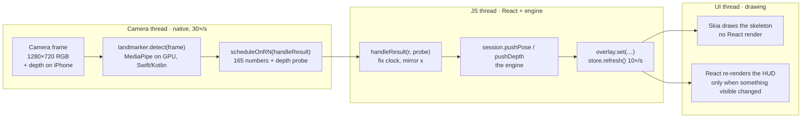
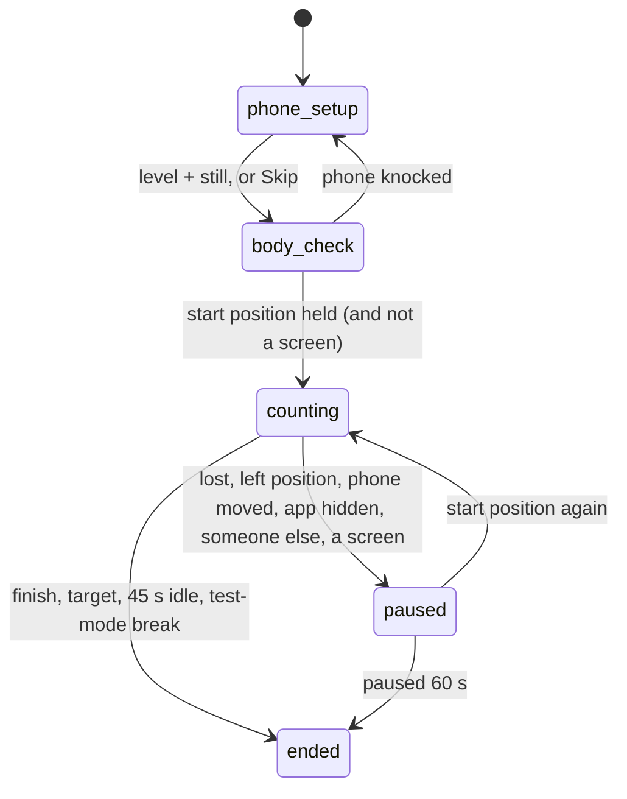

# How Trueline runs

This guide follows the code in the order it runs: the app starting, a set opening, a camera frame passing through the pose model and the engine, a push-up being counted or a plank being timed, the real-person check, and the set being saved. Every step names the file and function that does it, so you can open the code next to it.

Trueline has two exercises that share almost everything: the camera, the pose model, smoothing, the phone and framing checks, pauses and storage. They differ in one place: push-ups go to a **rep counter**, the plank goes to a **hold timer**.

## Contents

0. [Three ideas that explain everything](#0-three-ideas-that-explain-everything)
1. [App launch to Home](#1-app-launch-to-home)
2. [Opening a set: what gets created](#2-opening-a-set-what-gets-created)
3. [The journey of one camera frame](#3-the-journey-of-one-camera-frame)
4. [Inside the engine: what happens to a frame](#4-inside-the-engine-what-happens-to-a-frame)
5. [The session phases](#5-the-session-phases)
6. [Counting one push-up](#6-counting-one-push-up)
7. [Timing a plank](#7-timing-a-plank)
8. [The real-person check](#8-the-real-person-check)
9. [From the engine to the screen and speaker](#9-from-the-engine-to-the-screen-and-speaker)
10. [The phone level sensor](#10-the-phone-level-sensor)
11. [Timers, background and camera trouble](#11-timers-background-and-camera-trouble)
12. [Ending a set and saving it](#12-ending-a-set-and-saving-it)
13. [Every file, and what it's for](#13-every-file-and-what-its-for)
14. [Tracing a problem yourself](#14-tracing-a-problem-yourself)

---

## 0. Three ideas that explain everything

- **Three threads.**
  - The **camera thread** runs the pose model on each frame (and, on iPhone, reads depth).
  - The **JS thread** runs React and the engine.
  - The **UI thread** draws.

  Data moves one way: camera, then JS, then screen.
- **The brain is plain TypeScript.** `src/engine/` knows nothing about React, the camera or the phone. You push inputs in (`pushPose`, `pushAttitude`, `pushDepth`, `tick`). It sends events out, and you can read a snapshot. That's why it can be tested in Node. One class, `PushupSession`, runs both exercises; the name is from before the plank existed.
- **One hook connects the two.** `useSessionController` creates the engine for a set and wires it up:
  - in: camera frames, depth readings, the motion sensor, timers, app background;
  - out: voice, banners and the skeleton overlay.



---

## 1. App launch to Home

1. **`package.json` → `"main": "expo-router/entry"`**
   - Expo Router is the entry point. It scans `src/app/` and turns each file into a screen.
   - For example, `index.tsx` is `/`, `session.tsx` is `/session`, and `summary/[id].tsx` is `/summary/123`.
2. **`src/app/_layout.tsx` · `RootLayout`** runs once and wraps every screen.
   - Keeps the splash screen up until the fonts load. If fonts fail, it carries on with system fonts.
   - Locks the app to portrait and sets the teal background.
   - Declares the 6 screens in a `Stack`. Settings opens as a modal, and the session screen can't be swiped away.
   - Exports `ErrorBoundary`, so a crash in any screen shows `ErrorScreen` with a Retry button instead of closing the app.
3. **`src/app/index.tsx` · Home → `src/storage/settings.ts` · `useSettings`**
   - `useSettings()` reads key `settings.v1` from `expo-sqlite/kv-store` synchronously.
   - `normalizeSettings` then fills any missing or broken field with its default. Settings saved before the plank existed load as push-ups.
   - If `experience` is still `null` (first launch), Home returns `<Redirect href="/welcome">`.
4. **`src/app/welcome.tsx`** asks one question: "Guide me" or "Keep it quick".
   - The choice is saved with `update({ experience })`, then `router.replace('/')` returns to Home.
   - Guided adds the guide screen, spoken explanations and setup pictures.
5. **`src/app/index.tsx` · `reload()` → `src/storage/history.ts`**
   - Runs every time Home comes into focus, and when the app comes back from the background.
   - `listSessions()` loads the history list.
   - `listSessionsSince(6 days ago)` feeds `dailyTotals()`, which returns push-up reps and plank time per day. The hero number and the 7 week bars follow the picked exercise; the other exercise's total for today shows underneath.
   - The first database call opens `trueline.db`, creates the `sessions` table if needed, and `migrate()` adds the plank columns (`exercise`, `hold_ms`) to a database from before planks existed.
6. **Pickers and the Start button**
   - **`ExercisePicker`** (`src/ui/ExercisePicker.tsx`): two tiles, Push-ups and Plank, each with its own icon (`ExerciseGlyph`).
   - The setup sketch (`SetupDiagram`) shows the straight-arm start for push-ups and a forearm plank for the plank.
   - Difficulty chips, with wording from `difficultyCopy(level, exercise)`.
   - Targets: reps (`TARGETS`) for push-ups, or `HOLD_TARGETS` (0:30 to 2:00) for the plank.
   - Each tap calls `update(patch)`, which saves to the key-value store and tells every mounted `useSettings` hook.
   - **Start a set** opens `/guide` in guided mode, otherwise `/session`. `useTapGuard` ignores a second tap, so a double tap can't open two sessions.

---

## 2. Opening a set: what gets created

Everything here happens in `src/app/session.tsx`. The screen is two components: `SessionScreen` checks that a set can start, and `LiveSession` runs it.

1. **`SessionScreen`**
   - Copies the settings once with `useState(liveSettings)`, so changing a setting mid-set doesn't affect that set.
   - Reads `?demo=`, and picks the camera:
     - the front or back camera you chose, falling back to the other one;
     - on iPhone with the real-person check on, the same-side camera that can also see depth (`useCameraDevices()` → `mediaTypes.includes('depth')`): the front TrueDepth camera or the back dual camera.
   - Keeps the screen awake. `useFocusEffect` locks the screen to landscape or portrait while it's in front, and back to portrait when you leave.
2. **`SessionScreen` · gates.** Early returns show a full-screen `Gate` (`features/session/Gate.tsx`) when:
   - camera permission hasn't been given yet (an "Allow camera" button);
   - permission was refused before (a button to open Settings);
   - no camera is found.
3. **`LiveSession` · `useSessionController(settings, onEnded)`** creates everything for this one set:
   - `new PushupSession(…)` with:
     - `config: sessionConfig(settings)` (`src/session/sessionConfig.ts`): the level's limits for this exercise, test mode, and whether the real-person check is on;
     - `exercise`: `'pushup'` or `'plank'`;
     - `targetReps` or `targetHoldMs`.
   - `new Coach(voice)`.
   - A `Recorder`, only if "Record sets for tuning" is on.
   - The snapshot store and the overlay shared value.
   - The engine event subscription and the timers (section 9).
4. **`LiveSession` · `usePoseStream({ modelPreference, onPose, depth, onDepth })`**
   - Gets the native pose module with `getPoseLandmarker()`.
   - Loads the model in the background with `landmarker.load({ model: 'full', delegate: 'gpu' })`.
   - Returns `outputs` for the camera (the frame output, plus a depth output when `depth` is on) and `onCameraStarted`, which starts pairing depth with frames (section 3b).
5. **`LiveSession` · `usePhoneAttitude(…)` and `useDemoFeed(…)`**
   - Starts the motion sensor, which sends readings to `ctrl.onAttitude`.
   - In demo mode the sensor is off. `useDemoFeed` plays a scripted synthetic body into the same `onPose` and `onAttitude` functions: reps for push-ups, a hold with a slow sag for the plank.
6. **`LiveSession` · more gates.** Full-screen stops when:
   - `pose.status === 'unsupported'`: the native module is missing, as in Expo Go;
   - `'error'`: the model failed to load (offers Try again and Use the light model);
   - `cameraError`: the camera failed (offers Restart camera and Finish set).
7. **`LiveSession` · render.** Layers, bottom to top:
   - `<Camera outputs={pose.outputs} onStarted={pose.onCameraStarted} constraints={[{fps: 30}]}>`. It mirrors for the front camera, and its orientation follows the locked screen.
   - `StageDecor`: a tint over the video, the dotted outline (`PlankGhost`: straight arms for push-ups, a forearm plank for the plank), and the edge hints from `AlignmentGuide`.
   - `SkeletonOverlay`.
   - `Hud`: the setup panels, the rep count (`CountColumn`) or the plank clock (`TimerColumn`), the banner and the Finish button.

---

## 3. The journey of one camera frame

This runs about 30 times a second. Files:
- `src/camera/usePoseStream.ts`
- `modules/pose-landmarker/ios/HybridPoseLandmarker.swift` (Kotlin on Android)
- `src/session/useSessionController.ts`

1. **Camera thread · VisionCamera → `onFrame(frame)` worklet**
   - VisionCamera captures a frame in HD 16:9 and converts it to RGB.
   - It calls `onFrame`, a function marked `'worklet'` that runs on the camera thread, not in JS.
   - While the model is busy, new frames are dropped (`dropFramesWhileBusy`), so work never queues up.
2. **Camera thread · `landmarker.detect(frame)` → Swift `HybridPoseLandmarker.detect`.** Nitro calls straight into Swift with the frame, no copy. Swift then:
   - takes the pixel buffer and gives MediaPipe a timestamp that always increases (video mode requires it);
   - tells MediaPipe how the image is rotated;
   - runs `landmarker.detect(videoFrame:)`, which finds 33 body points;
   - rotates each point upright with `upright()`. MediaPipe returns them in the sideways sensor layout, which was the cause of the Easy-mode bug;
   - flattens the points into 165 numbers (33 × x, y, z, visibility, presence).
3. **Camera thread · `finally { frame.dispose() }`** always releases the frame and swallows any error. An exception escaping a frame callback can crash an iOS release build.
4. **Camera thread → JS thread · `scheduleOnRN(handleResult, r, probe)`**
   - Sends the small `PoseResult` object to the JS thread: the numbers, width, height, `mirrored`, timestamp and inference time, plus a depth probe when there is one (3b).
   - The pixels themselves never reach JS.
5. **JS thread · `usePoseStream` · `handleResult(r, probe)`**
   - Converts the native timestamp to the JS clock (`performance.now()`), using an offset that follows the smallest delay it has seen.
   - Unpacks the 165 numbers into 33 `Landmark` objects. For the front camera it flips `x = 1 − x`, so points match the mirrored preview.
   - Calls `onPose(sample)`, which is `ctrl.onPose`, and `onDepth(probe)` (`ctrl.onDepth` → `session.pushDepth`) when a probe came with it.
   - Once a second it works out the frame rate and average inference time. In Auto, if the full model averages over 55 ms for 3 seconds in a row, it switches to lite with `load('lite', true)`.
6. **JS thread · `useSessionController` · `onPose(s)`**
   - Calls `session.pushPose(s)` (section 4).
   - Records the frame if recording is on.
   - Takes the smoothed points for the side facing the camera (shoulder, elbow, wrist, hip, knee, ankle, ear) and writes them, with a colour state, to `overlay.set(…)`.
7. **UI thread · `src/ui/SkeletonOverlay.tsx`**
   - `useDerivedValue` reads the shared value on the UI thread.
   - `project()` maps each point onto the screen with the same cover or contain maths as the camera preview.
   - Skia draws the arm and the body line. The body line is coloured by `bodyState`: green good, amber needs attention, red fault, chalk not measuring yet. For the plank it follows the hold timer: green running, amber slipping, red clock stopped.

### 3b. With depth (iPhone, real-person check on)

When the camera can see depth, `usePoseStream` adds a depth output and, once the camera has started (`onCameraStarted`), pairs it with the frame output:

1. `VisionCamera.createOutputSynchronizer([frameOutput, depthOutput])` delivers each frame together with the depth map taken at the same moment. It can only be created once both outputs are connected to a running camera, which is why it waits for `onStarted`.
2. Its callback, `onSynced`, runs on the synchronizer's own thread (a worklet runtime from `createWorkletRuntimeForThread`). It runs the pose model as above and, every third frame, calls `sampleDepthAtBody` (`src/camera/depthProbe.ts`):
   - reads depth at the near-side joints and at points in the space above the back;
   - maps upright landmark positions back into the depth map's own rotation (the reverse of `upright()`);
   - handles 32-bit, 16-bit and disparity formats;
   - tries the map both mirrored and not, and keeps the reading where the body stands out more;
   - works out the real torso length from the camera's focal length (`cameraCalibrationData`) and the body's distance.
3. If pairing fails, or no paired frame arrives within 3 seconds, `depthStatus` becomes `failed`: the depth output is removed and the plain frame path takes over. Android never uses this path (the synchronizer is iOS-only).

---

## 4. Inside the engine: what happens to a frame

`PushupSession.pushPose` in `src/engine/session.ts` first cleans the frame and turns it into measurements, then hands it to the current phase.

1. **`tracker.ts` · `PoseTracker.update(sample)`** cleans the raw points:
   - Drops frames with a bad or repeated timestamp. Resets after a gap over 500 ms or a change of frame size.
   - For each of the 33 points, visibility = `min(visibility, presence)`.
   - A point at 0.5 or above is smoothed with a **One Euro filter** (`oneEuro.ts`) and converted to pixels.
   - A point that drops out keeps its last good position for 200 ms, then counts as missing.
   - Result: a `TrackedPose`.
2. **`tracker.ts` · `SideSelector.update(pose)`**
   - From the side, the far arm is hidden but the model still guesses it.
   - It scores each side by the average visibility of 6 joints and uses the clearer one.
   - It only switches when the other side leads by 0.15 for a full second, so the overlay never flickers between arms.
3. **`tracker.ts` · `buildChain` + `computeMetrics`**
   - Turns the 7 joints of that side into `BodyMetrics`, the numbers every rule uses.
   - It needs a visible shoulder and hip.
   - A measurement whose joints are hidden is `null`, meaning "unknown". It is never treated as a pass or a fail.

   | Measurement | How it's computed | Used for |
   |---|---|---|
   | `elbowDeg` | angle shoulder–elbow–wrist (180° = straight arm) | rep depth and lockout; forearm plank (about 90°) |
   | `shoulderHeight` | (wrist.y − shoulder.y) ÷ torso length | shoulder drop, which confirms depth |
   | `bodyLineDeg` | angle shoulder–hip–ankle | start check, hip faults, plank line |
   | `hipOffset` | hip distance from the shoulder→ankle line ÷ torso (+ sag, − pike) | hips sagging or piking; the plank's hips gauge |
   | `trunkTiltDeg` | angle of shoulder→ankle (or →hip) from horizontal, corrected for phone roll | "Get into position", standing up |
   | `kneeDeg`, `neckDeg`, `wristOffset` | hip–knee–ankle, ear–shoulder–hip, wrist distance from under the shoulder | legs, head, hand position |
   | `elbowStack` | elbow distance from under the shoulder ÷ torso | forearm plank: elbows under shoulders |
   | `forearmRise` | height between wrist and elbow ÷ torso (≈ 0 when the forearm lies flat) | telling a forearm plank from a push-up's bottom |
   | `torsoPx`, `hipCenter` | shoulder-to-hip length, hip position | scale, spotting a different person |

4. **`session.ts` · route by phase.** What runs next:
   - `phone-setup`: `evaluatePhone()`, plus a framing preview;
   - `body-check`: `evaluateBody()`;
   - `paused`: `evaluateBody()` with a shorter hold (after a `not-real` pause, only once there has been no sign of a screen for 2 s);
   - `counting`: `evaluateCounting()`.
5. **`evaluateBody` → `gates.ts` · `FramingGate.check`** checks whether the body is usable.
   - It reports one issue at a time: `no-person`, `show-feet`, `show-head`, `move-back`, `move-closer`, `turn-sideways`, `low-light`.
   - Easy doesn't require feet or head, only shoulder, elbow, wrist and hip.
   - A single bad frame during a hold is ridden out for 350 ms.
6. **`evaluateBody` → `smoothing.ts` · `MetricMedian` → `gates.ts` · `checkPlank(metrics, cfg, exercise)`**
   - The measurements first go through a 5-frame median. This removes one-off misreads, such as a knee read at 118° in a straight plank.
   - `checkPlank` lists what's wrong, most important first: `get-down`, `straighten-legs`, `hips-sagging`/`hips-high`, `straighten-arms`, `hands-under-shoulders`, `elbows-under-shoulders`.
   - For push-ups the start is always a high plank. For the plank exercise, `isForearmPlank()` also accepts forearms on the floor (wrist level with the elbow, elbow bent 50–135°), and the hips are checked against the hold limits so a hold never starts already broken. The result includes the `variant` (`high` or `forearm`).
   - Easy push-ups only check `get-down` and `straighten-arms`.
7. **`evaluateBody` → `gates.ts` · `PlankHold.update`** times the start hold: 0.5 s Easy, 0.9 s Medium, 1.2 s Hard.
   - Shoulders moving more than `maxWobble` torso lengths restarts the timer, with the cue "hold still".
   - Failing readings shorter than 350 ms don't reset it.
   - When the hold completes, it returns a **Calibration**: your top shoulder height, torso size, your own straight-arm angle, your body line and hip position, and the side used.
   - If the real-person check already sees a screen, the set does not start (cue `not-real`).
   - Otherwise `beginCounting(cal)` creates the `RepCounter` (push-ups) or the `HoldTimer` (plank).

---

## 5. The session phases

The whole set is one state machine in `PushupSession`. Every phase change goes through `setPhase()`, which resets the right things and sends a `phase` event.



"Counting" is the active phase for both exercises: reps are counted, or the plank is timed.

| Change | What triggers it | Code |
|---|---|---|
| phone-setup → body-check | The phone is within the roll and lean limits and still for `steadyMs`. Or the user taps Skip (Easy and Medium), or "Phone is set" when there's no sensor. The current angle is saved as the resting angle. | `evaluatePhone`, `confirmPhoneManually`, `PhoneGate.acceptCurrent` |
| body-check → counting | Framing OK, start position OK, held long enough without wobble, no sign of a screen. | `evaluateBody` → `beginCounting` |
| body-check → phone-setup | The phone clearly moved from its resting angle. | `pushAttitude` → `isDisturbed` |
| counting → paused | See the list below. | `markLost`, `evaluateCounting`, `evaluateHold`, `flagNotReal`, `tick`, `interrupt` |
| paused → counting | The start position is held again for 60% of the normal time. Reps and plank time are kept. After `phone-moved`, the phone has to settle first; after `not-real`, there must be no sign of a screen for 2 s. | `pushPose` paused branch → `beginCounting` |
| counting → ended | Finish tapped twice; the target reached (reps, or plank time in good form); 45 s with no rep, or 45 s with the plank clock stopped; in plank test mode, the first real form break. | `end('user' \| 'target' \| 'idle' \| 'form-break')` |
| paused → ended | Paused for over 60 s. Time while the app was hidden doesn't count. | `tick` → `end('paused-too-long')` |

Each pause reason, and what triggers it:

- `lost-tracking`: no usable body, or no frames at all, for 2 s.
- `left-position`: for 2 s, either the tilt is more than 20° over the limit (you stood up) or the knees are bent under 110° (you sat back). For the plank this is judged on the median-smoothed readings.
- `other-person`: compared with the median of the last five accepted frames, the hip moved more than 25% of the frame, the torso size changed more than 35%, or both changed clearly at once.
- `phone-moved`: the phone was knocked.
- `interrupted`: the app was hidden, a phone call came in, or another app took the camera.
- `not-real`: the real-person check found a video on a screen (section 8).

---

## 6. Counting one push-up

While counting push-ups, each frame goes through `evaluateCounting` (session.ts), then `RepCounter.update` (repCounter.ts). The numbers below are Easy; the table at the end has all three levels.

1. **Checks before counting** (shared with the plank). Each one stops the frame if it fails:
   - A sudden jump in body position or size means a different person, so the frame is ignored (and the hand and foot history used by the real-person check is wiped).
   - The framing hints are refreshed, so "low light" can still show mid-set.
   - No elbow angle and no shoulder height means the body is lost; 2 s of that pauses the set.
   - The real-person check gets the hands and feet; a sustained sign of a screen pauses the set (section 8).
   - Standing up or kneeling stops feeding the counter; 2 s of it pauses the set.
2. **What the counter receives.**
   - The **raw** elbow angle and shoulder height, so a fast rep isn't blurred.
   - The **median-smoothed** body line, hip offset and neck angle, so one bad frame can't fail your form.
   - `depthProgress` fills the depth gauge.

```
            elbow < lockout − 8°   elbow ≤ 110° + shoulders dropped   elbow > 110°
   ┌─────┐ ─────────────────▶ ┌────────────┐ ───────────▶ ┌────────┐ ─────▶ ┌───────────┐
   │ top │                    │ descending │              │ bottom │        │ ascending │
   └─────┘ ◀──────────────────┴────────────┴──────────────┴────────┴─────── └───────────┘
                         elbow ≥ lockout  →  +1 rep
```

The gap between the "down" angle (110°) and the lockout angle is the hysteresis. Jitter around one threshold can't count twice, because a rep has to cross both.

**The lockout angle is personal.** Arms rarely read 180° on camera, so `lockoutFor()` starts from the elbow angle you held during the start plank:

```
lockout = max(down + 15, min(upElbowDeg, plankElbow − 8))
// Easy, plank arms read 150°:
lockout = max(125, min(145, 142)) = 142°
```

Shoulder drop is measured against your calibrated top height. 0 means at the top, and 1 means the shoulders dropped 40% of that height.

**Attempts that don't count:**
- `not-deep-enough`: came back up after dipping past ~130°, but before reaching 110°.
- `no-lockout`: rose past 120°, then went back down without locking out.
- `too-slow`: one attempt took over 10 s (lying on the floor).
- `noise`: a "rep" under 300 ms is ignored silently.
- Elbow hidden: depth and lockout come from shoulder drop alone.

3. **`repCounter.ts` · `complete()`: judging the rep (Medium and Hard).** Form is judged on the whole rep, ignoring the worst 15% of frames (`percentile(…, 0.15)`).
   - Hips below the line: `hips-sagging`. Above it: `hips-piking`.
   - Faster than `rushedRepMs`: `rushed`.
   - A low neck angle is only a hint, `head-dropping`.
   - Score = 100 − 30 per fault − 5 per hint. **Clean** means no faults.
   - On Easy, `form.enabled` is false, so every full rep is clean.
4. **`session.ts` · after a rep**, in order:
   - The rep is stored and the idle timer restarts.
   - A `rep` event goes out, then a `rep` cue (the spoken count), then the first fault cue if there is one.
   - If the target is reached: a `target-reached` cue, then `end('target')`.

| Threshold | Easy | Medium | Hard |
|---|---|---|---|
| Bottom elbow angle (`downElbowDeg`) | 110° | 100° | 95° |
| Lockout cap (`upElbowDeg`) | 145° | 150° | 155° |
| Shoulder drop needed with elbow | 0.30 | 0.40 | 0.50 |
| Shoulder drop needed alone | 0.50 | 0.65 | 0.80 |
| Start plank hold | 0.5 s | 0.9 s | 1.2 s |
| Feet and head required in frame | no | yes | yes |
| Form faults | off | ±0.16 hips | ±0.12 hips |
| Phone tolerance (roll / lean) | 12° / 35° | 8° / 25° | 5° / 20° |

Hard is simply `DEFAULT_CONFIG` in `config.ts`. Easy and Medium are partial overrides in `difficulty.ts`, merged in by `mergeConfig`.

---

## 7. Timing a plank

For the plank, `evaluateCounting` runs the same checks as step 1 above, then hands the frame to `evaluateHold` (session.ts), which feeds **median-smoothed** readings to `HoldTimer.update` (`holdTimer.ts`). A plank is still, so smoothing costs nothing here.

**The clock only runs in good form.** The timer has three states:

```
   good ──(form slipping)──▶ warning ──(fault lasts the grace period)──▶ broken
    ▲                          │                                           │
    └───────(back in line)─────┘          good form for 0.5 s ◀────────────┘
```

- **good**: the clock runs.
- **warning**: the clock still runs; the hips are drifting towards a limit, slowly sinking, or a fault has started but not yet lasted the grace period. A problem must last 400 ms before it's warned about, so a misread joint never causes a warning.
- **broken**: the clock is stopped. A fault that outlasts the grace period (2 s Easy, 1.5 s Medium, 1 s Hard) becomes a **break**, and the grace seconds are taken back too, so only time in good form counts. Good form must then hold for 0.5 s (`restoreMs`) before the clock runs again.

**What stops the clock** (`faultOf`):

| Fault | When | Levels |
|---|---|---|
| `dropped` | stood up (tilt over the limit + 20°), or knees down (under 110°) | all; knees are fine on Easy or with "Allow knees down" |
| `out-of-view` | feet out of view, so the hips can't be judged | Medium and Hard (they need the feet) |
| `knees-bent` | knees more than 10° under the start limit | Medium (< 135°) and Hard (< 145°) |
| `hips-sagging` / `hips-piking` | past the sag or pike limit, or clearly worse than your own start position, or the body line under its limit | all, with each level's limits |
| `arms-bent` | high plank: elbow 15–25° under the start limit | all |
| `elbows-under-shoulders` | forearm plank: elbow far from under the shoulder | all |

**What only warns** (`warningOf`): hips past 60% of the sag limit, or 75% of the pike limit (a slight hip raise gets more room); hips sinking faster than the level's trend speed over 2 s; and, on Hard, hands drifting from under the shoulders in a high plank. A dropped head is counted as a tip (`headDownMs`) and never stops the clock.

Switching from a high plank to the forearms mid-hold is fine: each frame is judged as whichever plank it looks like. The summary keeps the type you started in.

**Plank limits by level** (`PLANK_PRESETS` in `difficulty.ts`):

| | Easy | Medium | Hard |
|---|---|---|---|
| Body line | ≥ 145° | ≥ 155° | ≥ 165° |
| Sag / pike limit (torso lengths) | 0.20 / 0.25 | 0.14 / 0.18 | 0.10 / 0.12 |
| Grace before the clock stops | 2 s | 1.5 s | 1 s |

**What `evaluateHold` adds around the timer:**
- A `hold` cue for each warning or break, and `hold-restored` when the clock runs again.
- `hold-time` every 15 s of good form, and `hold-countdown` for the last 5 s to a target; then `target-reached` and `end('target')`.
- In test mode (`hold.endOnBreak`), the first break ends the set with `form-break`. A break is handled before the left-position pause, so standing up ends a test rather than pausing it.
- Standing up or kneeling for 2 s pauses the set, as for push-ups; the time is kept.
- 45 s with the clock stopped ends the set (`idle`).

The timer also keeps the last few seconds of its totals, so `rewind(t)` can take back time the real-person check rejects.

---

## 8. The real-person check

`src/engine/reality.ts` · `RealityCheck` decides whether the camera is watching a real person or a video of one on a screen. Two independent signals; only sustained, clear evidence gives a verdict, and anything unclear gives none.

1. **Depth (iPhone): `pushDepth(probe)`.** Each depth probe (from `sampleDepthAtBody`, section 3b) becomes a vote:
   - **fake** if the real torso size is impossible (under 20 cm or over 1.5 m: a person on a phone screen), or the body stands out from the space above its back by less than 12 cm (a TV: everything on one flat surface);
   - **real** if it stands out by 25 cm or more;
   - no vote in between, or when there aren't enough readable points.

   Verdict `screen`: at least 6 votes in the last 3 s, 75% or more of them fake.
2. **Handheld screen (every phone): `pushContacts(t, points, phoneStill)`.** During counting, the session passes the wrist and ankle positions and whether the motion sensor says the phone is still.
   - With the phone moving, or without a motion sensor, this check is off.
   - Verdict `handheld`: for 3 s, the hands and feet move at a typical speed of at least 0.045 frame-widths per second, *together* (their midpoint moves at least twice as much as the gap between them changes), and mostly back and forth. Camera noise moves each joint on its own; a screen held up to the camera moves them all at once.
   - Frames the other-person check rejects wipe this history (`distrustContacts`), because the smoothing filter carries a rejected frame into the next few.

**When it fires**, `flagNotReal` (session.ts):
- takes back reps that ended after the suspicious stretch began (a `revoke` event trims the tally) and rewinds the plank clock to that moment;
- pauses with `not-real`: a red "Real person needed" panel and the voice line "Only a real person counts";
- keeps the set paused until there has been no sign of a screen for 2 s, then a fresh start position resumes it.

In body-check, a sustained verdict stops the set from starting (cue `not-real`, red headline in the setup panel). The summary records `realityFlags`. **Settings → Camera → Real-person check** turns all of it off (`reality.enabled`).

---

## 9. From the engine to the screen and speaker

The engine never touches the UI. Results leave it by three routes, each suited to how often the data changes.

| Route | What travels on it | How |
|---|---|---|
| **A · events** | Things that happen once | `session.subscribe(fn)` in useSessionController. Each event type: `cue` → `cueSpeech()` → `coach.say()`, and `cueBanner()` → a banner for 2.2 s. `rep` → a tally mark. `revoke` → tally marks taken back. `phase` → haptic tap, start time, immediate refresh. `ended` → `onEnded(summary)`. |
| **B · snapshot** | State shown as text | Every 100 ms `store.refresh()` takes `session.snapshot()` and builds a rounded key from it (`visibleKey`), including the plank clock's whole seconds, state and hips position. Only when the key changes do components using `useSnapshot()` re-render. The camera never re-renders. |
| **C · shared value** | The skeleton, every frame | `overlay.set()` writes a Reanimated shared value. Skia reads it on the UI thread: 30 updates a second, zero React renders. |

1. **`session.ts` · `cue()`** keeps the engine from chattering.
   - The same cue isn't repeated within 3.5 s.
   - Cues of the same kind wait 1.75 s.
   - Rep counts, "start", "paused", plank breaks, time calls and the countdown skip both limits.
2. **`session/copy.ts` · `cueSpeech` / `cueBanner`**
   - Turns a cue such as `{ kind: 'plank', issue: 'straighten-arms' }` into words: a short headline, detail text and a spoken line. Wording depends on the exercise (`plankIssueCopy`, `pauseCopy`, `difficultyCopy`); plank faults use `HOLD_COPY`, the real-person check uses `REALITY_COPY`.
   - Guided mode speaks the detail; quick mode speaks the short line.
   - **All user-facing text lives in this file.**
3. **`session/coach.ts` · `Coach.say(text, priority)`** uses `expo-speech`, the phone's own offline voice.
   - **high** cuts off whatever is being said, so rep counts, time calls and "Clock stopped" are on time.
   - **queued** plays after the current line ("Target reached", "Time. Nice hold.").
   - **normal** is dropped if the coach is already speaking.
   - The same text within 1.5 s is skipped.
4. **What the live screen shows** (`src/features/session/LiveHud.tsx`):
   - push-ups: `CountColumn` (count and tally) and, in landscape, `DepthColumn`;
   - plank: `TimerColumn` (the clock, white running, amber slipping, red stopped, plus target progress and breaks) and, in landscape, `LineColumn` with `LineGauge` (hips: a bubble on the line, rising for pike, sinking for sag);
   - `PausedPanel`, red for a `not-real` pause.

---

## 10. The phone level sensor

1. **`sensors/usePhoneAttitude.ts`**
   - Checks that `DeviceMotion` is available and has permission, then listens 10 times a second.
   - With no sensor or no permission, it reports that, and the setup panel offers "Phone is set" instead.
2. **`engine/attitude.ts` · `attitudeFromGravity(x, y, z, orientation)`**
   - The gravity direction gives **roll** (sideways tilt from the picked orientation) and **pitch** (leaning back or forward).
   - The signs are arranged so iOS and Android, and either landscape side, read the same.
   - Rotation speed tells whether the phone is still moving.
3. **`session.ts` · `pushAttitude` → `gates.ts` · `PhoneGate`.** What happens depends on the phase:
   - **phone-setup:** `check()` names one issue (`stand-up`, `wrong-orientation`, `tilted-sideways`, `leaning`, `moving`), or fills the steady timer.
   - **body-check and counting:** `isDisturbed()` compares with the resting angle saved at the start. It allows 3 × the roll limit (max 30°) and 2.5 × the lean limit (max 50°), so a phone whose level check was skipped still has to stay put.
   - **always:** `horizonRoll()` lets `computeMetrics` remove a slightly crooked phone from the trunk tilt.
   - **real-person check:** rotation speed under 3°/s means "phone still", which the handheld-screen check needs.

---

## 11. Timers, background and camera trouble

| Source | Rate | What it does |
|---|---|---|
| `session.tick(now)` | every 250 ms | Lets timeouts fire when no frames arrive: lost tracking after 2 s, idle end at 45 s, paused end at 60 s. It also re-checks the phone during setup, so a dead sensor shows "Place your phone". |
| `store.refresh()` | every 100 ms | The UI snapshot (route B). |
| `sendDiagnostics()` | every 1 s, dev only | POSTs one status line to `scripts/diag-server.mjs` on the Mac. |
| `AppState` change | event | Hidden: `session.interrupt()` pauses with `interrupted`, drops any start hold in progress and resets the real-person evidence. Back: `resumeFromInterrupt()` resets tracking, and you take the start position again to carry on. |
| Camera `onInterruptionStarted / Ended` | event | Same as above, through `ctrl.interrupt / resume`. The `away` ref tracks the app and camera separately, and both must be back before the set resumes. |
| Camera `onError` | event | Pauses the set and shows "Camera stopped", with Restart camera (a new `key` remounts it) or Finish set. |
| Depth watchdog | once, 3 s after pairing | No paired frame since pairing started: drop depth and use plain frames. |

---

## 12. Ending a set and saving it

1. **`session.tsx` · `Hud` · `requestEnd`**
   - With nothing to save (0 reps, or under 1 s of plank in good form; `hasWork`), Close just leaves.
   - Otherwise the first tap shows "Tap again to finish" for 3 s, and the second tap calls `ctrl.end()`.
   - Android back and swipe-away are caught by `usePreventRemove` and go through the same confirm-and-save.
2. **`session.ts` · `end(reason)` → `buildSummary`**
   - Stops the active clock and builds a `SessionSummary`: the exercise; every rep and miss, fault and miss counts, average rep time, average score, best clean streak; the number of pauses and real-person flags; and for the plank, `hold` (time in good form, total time, longest unbroken hold, breaks, time per fault, head-down time, form %).
   - Moves to `ended` and sends the `ended` event.
3. **`session.tsx` · `onEnded(summary)`**
   - `saveSession(summary, wallStart)` inserts a row in SQLite: the summary columns, `exercise`, `hold_ms`, plus the full summary as JSON. It's skipped for demo sets, for push-up sets with 0 reps, and for planks under 1 s in good form.
   - `setLastSummary()` keeps the result in memory, so the summary still shows if saving failed.
   - If tuning recording is on: `Recorder.finish()` → `saveRecording()` writes a JSON file (with the exercise) to Documents/recordings.
   - Lifts the back guard and calls `router.replace('/summary/<id>')`.
4. **`summary/[id].tsx`**
   - Uses the in-memory result when the id matches (or is `last`).
   - Otherwise it reads the row with `getSession(id)` and checks the JSON with `normalizeSummary`, so an old or broken record can't crash the screen. Old records without an exercise are push-ups; a plank whose JSON was lost is rebuilt from `hold_ms`.
   - Push-ups: the total, tally, faults, misses and each rep.
   - Plank (`PlankResult`): time in good form, a form % bar, longest hold, breaks, plank type, a "Next time" tip and time lost per fault.
   - Done goes back to Home, which reloads the history on focus.
5. **`useSessionController` · unmount**
   - After a normal end, the last spoken line is allowed to finish over the summary.
   - After an abandoned set, the coach goes quiet straight away.

---

## 13. Every file, and what it's for

### `src/app/`: screens (Expo Router)
| File | What it does |
|---|---|
| `_layout.tsx` | Root stack, fonts, splash, portrait lock, app-wide error screen. |
| `index.tsx` | Home: exercise picker, today's reps or plank time, week bars, difficulty and target chips, Start, history list. |
| `welcome.tsx` | First launch: guided or quick. |
| `guide.tsx` | Guided mode's "before your set" page: placement, framing, what counts as a rep or how the plank clock works. |
| `session.tsx` | The live set: camera choice (with depth), permission and model gates, camera, overlay, HUD, finish and back-button handling, saving. |
| `settings.tsx` | All preferences (including real-person check and plank test mode), plus the tuning recordings to share or delete. |
| `summary/[id].tsx` | The result of one set: push-ups or plank. |

### `src/engine/`: pure TypeScript, no React
| File | What it does |
|---|---|
| `session.ts` | `PushupSession`: the state machine for both exercises. Inputs, events, snapshot, summary, the plank's `evaluateHold`, the real-person wiring. |
| `tracker.ts` | `PoseTracker` (smoothing, dropouts), `SideSelector`, `buildChain`, `computeMetrics`. |
| `gates.ts` | `PhoneGate`, `FramingGate`, `checkPlank`, `isForearmPlank`, `PlankHold`: everything before counting starts. |
| `repCounter.ts` | `RepCounter` (push-ups): top → down → bottom → up, misses, form faults, score. |
| `holdTimer.ts` | `HoldTimer` (plank): good / warning / broken, grace and restore, faults and warnings, summary, `rewind`. |
| `reality.ts` | `RealityCheck`: depth votes and handheld-screen shaking → `screen` / `handheld`. |
| `config.ts` | Every threshold in one place, including `hold` (plank) and `reality`. The defaults are Hard. |
| `difficulty.ts` | Easy and Medium overrides, plank-only changes (`PLANK_PRESETS`), `difficultyConfig()`. |
| `types.ts` | Landmark indices (`LM`), `PoseSample`, `PhoneAttitude`, `BodyMetrics`, `Exercise`, `PlankVariant`. |
| `geometry.ts` | Angle at a joint, signed distance from a line, tilt from horizontal, median. |
| `oneEuro.ts` | The One Euro smoothing filter. |
| `smoothing.ts` | 5-frame median of the measurements, and `percentile` for form grading. |
| `attitude.ts` | Gravity vector → roll and pitch. |
| `recording.ts` | `Recorder` (a compact log of a real set, with its exercise) and `replay()`, which runs a recording back through the engine. |
| `testing/synth.ts` | Builds a fake side-view body (`hold`, `rep`, `plank`, `forearmPlank`, `timeline`) with noise, sag, hidden joints, clasped hands and an angled camera. Used by the tests and demo mode. |
| `__tests__/` | The test suites: `matrix`, `realdevice`, `stress` (push-ups); `plank`, `plankEdge`, `plankStress`, `plankReplay` (plank); `realPerson`; `regressions`. |

### `src/camera/`, `src/sensors/`: inputs
| File | What it does |
|---|---|
| `camera/usePoseStream.ts` | Camera frames → native model → `PoseSample`. Loading, errors, lite fallback, shared module lifetime; on iPhone, pairing depth with frames and falling back if that fails. |
| `camera/depthProbe.ts` | `sampleDepthAtBody`: depth at the body and above the back, and the real torso length, on the camera thread. |
| `sensors/usePhoneAttitude.ts` | Motion sensor → `PhoneAttitude`. |

### `src/session/`: glue between the engine and the app
| File | What it does |
|---|---|
| `useSessionController.ts` | Owns one set: engine, coach, recorder, timers, background handling, overlay, depth readings, dev diagnostics. |
| `sessionConfig.ts` | The engine config for a set: level, exercise, test mode, real-person check. |
| `snapshotStore.ts` | Throttled bridge from engine state to React (`useSnapshot`). |
| `copy.ts` | All words: setup messages, cues, push-up faults, plank faults, misses, pauses, the real-person alert, difficulty descriptions, durations. |
| `coach.ts` | Voice with priorities, plus haptic taps. |
| `lastSummary.ts` | The set that just ended, kept in memory. |
| `recordings.ts` | Save, list, share and delete recording files. |

### `src/features/session/`: live-set UI pieces
| File | What it does |
|---|---|
| `SetupPanels.tsx` | `PhonePanel` (level bubble, Skip) and `BodyPanel` (checklist for the exercise, hold bar, no-room tip after 6 s, real-person headline). |
| `LiveHud.tsx` | Rep count and tally, plank clock, depth gauge, hips gauge, cue banner, paused panel (red for a screen), tracking debug readout. |
| `AlignmentGuide.tsx` | Edge hints showing which way to move, from `snapshot.placement`. |
| `Gate.tsx` | Full-screen stop for permissions and errors. |
| `useDemoFeed.ts` | Plays a scripted synthetic set into the real engine (`?demo=1`): reps, or a plank with a slow sag. |

### `src/storage/`: on-device data
| File | What it does |
|---|---|
| `settings.ts` | Settings type, defaults, load and save, `normalizeSettings`, the shared `useSettings` hook, `TARGETS` and `HOLD_TARGETS`. |
| `history.ts` | SQLite `sessions` table (with `exercise` and `hold_ms`): migration, save, list, get, delete, daily totals of reps and plank time. |
| `summaryShape.ts` | Checks a stored summary field by field before it's shown, including the plank's `hold`. |

### `src/ui/`: shared look
| File | What it does |
|---|---|
| `theme.ts`, `primitives.tsx` | Colours, type and spacing; `Display`, `Body`, `Label`, `Mono`, `Button`, `Chip`, `Rule`. |
| `SkeletonOverlay.tsx` | Skia drawing of the tracked arm and body line. |
| `ExercisePicker.tsx` | The Push-ups / Plank tiles on Home. |
| `LevelVial.tsx`, `DepthGauge.tsx`, `LineGauge.tsx`, `Tally.tsx` | Bubble level, depth bar, plank hips gauge, tally marks. |
| `Diagrams.tsx`, `OrientationPicker.tsx` | SVG setup sketch (per exercise), rep diagram, plank diagram (`HoldDiagram`), exercise icons (`ExerciseGlyph`), dotted outline (`PlankGhost`), landscape/portrait picker. |
| `ErrorScreen.tsx`, `useTapGuard.ts` | Crash fallback screen; ignores double taps on navigation. |

### `modules/pose-landmarker/`: our native module
| File | What it does |
|---|---|
| `src/PoseLandmarker.nitro.ts` | The TypeScript interface. `npm run codegen` (nitrogen) generates the Swift/Kotlin base classes from it. |
| `src/index.ts` | `getPoseLandmarker()`: one shared instance, or `null` when the module isn't built in (Expo Go, tests). |
| `ios/HybridPoseLandmarker.swift` | Loads the model (GPU, then CPU), runs it per frame, rotates the points upright. |
| `android/…/HybridPoseLandmarker.kt` | The same on Android. It turns the frame into a rotated bitmap first. `PoseLandmarkerPackage.kt` registers it. |
| `models/*.task` | The full (9.4 MB) and lite (5.8 MB) MediaPipe models. |

Depth needs no code of ours on the native side: it uses VisionCamera's own depth output and synchronizer.

### Project root
| File | What it does |
|---|---|
| `app.json` | Name, `trueline://` scheme, bundle ids, camera and motion permission text, config plugins. |
| `scripts/fetch-models.mjs` | Downloads the two models on `npm install`, checking their size. |
| `scripts/diag-server.mjs` | Prints the dev diagnostics lines the phone sends. |
| `jest.config.js` | Runs the tests in Node with the `@/` path alias. |

---

## 14. Tracing a problem yourself

**"It won't start"**
- Read the headline on screen, find it in `copy.ts`, and note its key, for example `straighten-arms`.
- Search that key in `gates.ts` to see the exact rule and threshold. For the plank, check `isForearmPlank` too.
- Run `node scripts/diag-server.mjs` and watch `plank=`, `elbow=`, `tilt=` and `hold=` live.

**"It counted wrong" (push-ups)**
- Turn on Settings → Show tracking to see the skeleton and angles.
- Turn on Record sets for tuning, do the set, share the file, and put it in `fixtures/recordings/`.
- Write a test that calls `replay(recording)`, then change `config.ts` or `difficulty.ts` until it passes.

**"The plank clock stopped (or didn't)"**
- The banner and voice name the fault; find it in `HOLD_COPY` (`copy.ts`), then in `faultOf` or `warningOf` (`holdTimer.ts`).
- The diagnostics line shows `hold=<seconds>s/<state>(<fault>) <variant> hip=<offset> breaks=<n>`; the hips gauge and Show tracking show the same live.
- Limits are in the `hold` section of `config.ts` and in `PLANK_PRESETS` (`difficulty.ts`).

**"It said I'm not a real person"**
- The diagnostics line ends with `real=<ok|screen|handheld>(standout <m>m torso <m>m)`. A real person shows a stand-out well over 0.25 m and a torso of about 0.35–0.7 m.
- Depth rules are in `pushDepth`, shaking rules in `pushContacts` (`reality.ts`); the thresholds are the `reality` section of `config.ts`.
- If depth on a device is unreliable, turn off Settings → Camera → Real-person check and look at `depthStatus` in `usePoseStream`.

```bash
npm install                         # also downloads the models
npx expo run:ios --device           # native build (needed after Swift/Kotlin or new native packages)
npx expo start --dev-client         # JS changes reload live
npm test                            # engine tests in Node
npx tsc --noEmit && npx expo lint   # before calling anything done
node scripts/diag-server.mjs        # live engine readout from the phone
```

**Rule of thumb:** each kind of problem has its own place in the code.
- *When* something counts: `src/engine/` (`repCounter.ts` for push-ups, `holdTimer.ts` for the plank, `reality.ts` for the real-person check).
- *What the user sees or hears*: `src/session/copy.ts` and `src/features/session/`.
- *Getting frames and depth*: `usePoseStream.ts`, `depthProbe.ts` and the native module.
